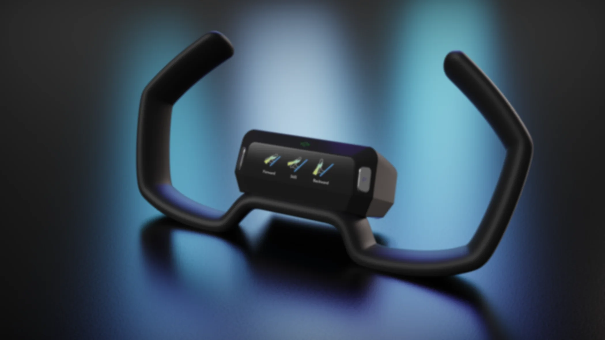

# HALOGRIP

HALOGRIP is a human-centred emergency steering concept that enables authorised first responders to reposition a stalled autonomous vehicle at low speed. It was developed by Sylvia Xie as a master's thesis at Chalmers University of Technology in collaboration with Autoliv.

[View the live prototype](https://sylviaxie.vercel.app/work/halogrip)



> HALOGRIP is a speculative design prototype, not a production Autoliv product or validated vehicle-control system.

## The design challenge

Purpose-built robotaxis may remove conventional steering controls, but emergency responders can still need to move a disabled vehicle when it blocks access to an incident. HALOGRIP explores how limited, local control could be made immediate, recognisable, glove-friendly, and clearly separated from normal autonomous operation.

The case study covers the problem context, user needs, concept exploration, form development, secure access, and a five-step handover sequence from authorisation to returning control to the vehicle.

## My role

Sylvia Xie led the user research, concept development, UX/UI design, interaction design, visual direction, prototyping, evaluation, and testing.

Her formal programming background is primarily in Python and MATLAB. For this prototype, she used AI-assisted coding tools to translate the design into a working Next.js frontend, while reviewing the implementation, testing behaviour, and iterating on the result. The repository is intended to demonstrate product thinking, interaction design, and the ability to turn a complex concept into a testable digital experience; it is not presented as production automotive software.

## Prototype highlights

- Scroll-directed Three.js product introduction with a static fallback.
- Responsive case-study narrative for desktop and mobile.
- Reduced-motion, WebGL-failure, and narrow-screen fallbacks.
- Keyboard-accessible concept exploration and image lightbox interactions.
- Deterministic state and projection tests for the most failure-prone animation logic.

## Technical overview

The prototype uses Next.js 16, React 19, TypeScript, GSAP, Lenis, React Three Fiber, and Three.js.

```text
HALOGRIP case study
├── scroll intro
│   ├── capability and lifecycle checks
│   ├── Three.js product scene
│   └── static and reduced-motion fallbacks
├── research and problem narrative
├── concept and form exploration
├── interaction handover sequence
└── final product details
```

This repository is a standalone review copy extracted from a larger portfolio project, so the original development history is not included. It contains no backend, database, authentication, production vehicle interface, or safety-critical control code.

## Run locally

Node.js 22.13.0 or newer is required.

```bash
npm ci
npm run dev
```

Open `http://localhost:3000`. The root route redirects to `/work/halogrip`.

## Verification

```bash
npm run check
```

The command runs ESLint, generated Next.js types and TypeScript checks, 17 unit tests, and a production build. Playwright scenarios are also included for routing, WebGL failure, and reduced-motion behaviour:

```bash
npx playwright install chromium
npm run test:e2e
```

The browser suite requires a local Playwright browser installation. WebGL performance can vary by browser, GPU, and device, so the enhanced 3D path still benefits from manual visual verification.

## Ownership and use

The concept, written case study, visual design, photographs, 3D model, and project-specific media are owned by Sylvia Xie. The repository is public for portfolio evaluation and code review; publication does not grant permission to reproduce or reuse its code or assets. See [LICENSE.md](LICENSE.md).
